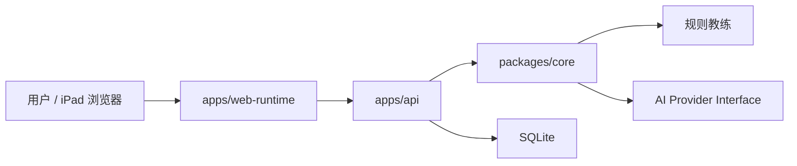

<div align="center">
  
  <h1>fox</h1>
  <p><strong>本地优先的个人生活助手，先保存真实记录，再逐步提供辅助。</strong></p>
  <p>
    <a href="https://github.com/li1fang/fox/blob/main/LICENSE"></a>
    
    
  </p>
</div>

## 项目简介

fox 是一个综合个人助手项目，目标是把饮食、医疗、健身、记账等日常记录变成一个可追溯、可复盘、可被 AI 辅助分析的个人生活日志系统。

当前重点是 **三动作训练的计数、视听引导与真实试用**。2026-10-23，Fox 0.6.8/build 25 已覆盖安装到 iPad，原训练、视觉档案与保留录像不变；完整软件回归、联网真机并行及正常启动已通过。当前冻结候选，等待自然试用；离线专项按用户决定后置，不承诺已经验证。范围、限制与简短清单见 [A0–A6 执行记录](docs/planning/NEXT_TRAINING_TRIAL_EXECUTION_V1.zh-CN.md)。通用文字/照片记录继续作保护性回归；本轮没有更新 iPhone 真机，历史入口见 [N3 实施记录](docs/planning/HOME_LOCAL_CAPTURE_N3.zh-CN.md)。分析、双设备和云端互联仍为后续计划。

既有 Fox 主应用仍以原生界面完成计划、训练、休息、反馈与记录确认，核心流程在 iPad 本地运行。D1 本地关键点已在 M4 真机运行；Part 1 候选已把两个指定机位的视觉计数接入正式训练记录，自动观测和人工确认分开保存。候选不等于 M4 真人验收通过，原训练数据与验收边界继续保留。

fox 的核心边界很明确：

- AI 负责计划、建议、鼓励、解释和总结草稿。
- 状态推进、计时器、危险停止和最终落库由确定性程序控制。
- 视觉先覆盖少数明确动作，记录必须可纠正；不运行本地大模型。

## 当前能力

- 通用记录存储核心：文字/照片、发生与记录时间、来源、修订、查询、删除及本地备份恢复；独立于训练文件，保存不依赖 AI 或网络。新 Home 候选接入文字/照片、分页、详情、更正、删除和文件备份；分析、发生时间编辑与完整搜索后置。
- 原生 Fox iPad App：计划编辑/JSON 导入、手动组记录、时间戳计时、休息、反馈多选、总结修订、历史与 JSON 导出。
- iPad 本地持久化：未完成训练可恢复；核心流程无需 Mac 网页、API 或 Linux 服务。
- 独立视觉页：侧身弯举 / 正面侧平举，以及有限适配的背面高位下拉；计数、阶段观察、人工纠正与诊断记录分开。保留机位信息；缓存回归不等于所有现场准确率通过。
- 本地视听引导：报数、准备/恢复提示、有限鼓励、半透明阶段叠加与一键静音。计划节拍和观察事实分开，短阶段提示可取消，不补造缺失返回时长，不提供动作标准评分。
- Part 1 候选：训练页视觉辅助、逐组观察段与中断恢复、左右人工核对、保留自动原值、独立节奏事实与“动作质量未评估”；可编辑 Day 1 草稿不预设重量。进展及未通过项以执行记录为准。
- 本地 Web Runtime UI：check-in、计划确认、动作执行、组后反馈、休息倒计时、总结确认。
- SQLite 持久化：保存 session、event log 和 confirmed fitness Entry。
- 训练状态机：覆盖 `idle`、`awaiting_approval`、`active_exercise`、`feedback`、`rest_timer`、`summary_pending`、`confirmed` 等状态。
- 规则教练：睡眠差、疲劳高、没跟上、太轻松、疼痛等场景有确定性处理。
- 器材档案：家庭健身房器材可以编辑，并进入计划草稿上下文。
- 历史推荐：根据 confirmed 训练记录推荐同动作重量和次数。
- AI 接口地基：已有 provider、schema 校验、fallback 和 audit，等待接入真实大模型。
- Fox Say 预览：已有 iPad/Web 录音上传、浏览器听写/朗读、本地 capture API，以及 VCompose Linux ASR/TTS roundtrip smoke 交接路径。

## 快速开始

手机候选的定向链路（只处理 Fox，不触碰 iPad 安装；须先完成开发者模式）：

```bash
npm run iphone:doctor
npm run iphone:build
npm run iphone:install
npm run iphone:open
```

手机历史阶段状态见 [手机首次候选](docs/planning/HOME_IPHONE_CANDIDATE_V1.zh-CN.md) 与 [N3 本地闭环](docs/planning/HOME_LOCAL_CAPTURE_N3.zh-CN.md)。更新前处理未保存输入并备份数据；签名/真机启动与模拟器测试分开验收。当前 iPad 试用候选已安装，不需要为了开始试用再次运行安装命令。

原生 iPad 应用（macOS、完整 Xcode、XcodeGen、已配对并开启开发者模式的 iPad）：

```bash
npm run ipad:doctor
npm run ipad:run
```

这会构建、安装和打开 Fox，不启动 Web/API。原生验证：

```bash
npm run test:native
npm run test:ipad:ui
```

通用记录核心的独立自动验收（依赖和证据边界见 [存储规格](docs/journal/RECORD_STORAGE_V1.zh-CN.md)）：

```bash
npm run test:journal
npm run test:native:all
```

App 层的真实存储集成测试使用 iOS 模拟器，另需 XcodeGen：`npm run test:home`。双尺寸 UI 的选择方式见 [自动化流水线](docs/automation.md)。

打开已安装应用的本地视觉验证页：

```bash
npm run ipad:vision:open
```

首次使用需允许相机；不依赖服务器。真实计数与性能验收见 [D1 规格](docs/fitness/D1_LOCAL_POSE_SPEC.zh-CN.md)。

完整视频回放、主体选择与逐事件验收见 [D1 回放记录](docs/fitness/D1_VIDEO_REPLAY.zh-CN.md) 和 [Part 1 执行记录](docs/fitness/REAL_EXERCISE_DAY_1_PART_1_EXECUTION.zh-CN.md)。私有语料在 `.data/vision-corpus/`，不进入 git；`vision:video` 重用全画面数值缓存，`vision:check` 与 `vision:cycles` 分别检查顶峰和完整循环，不以总数吻合代替验收。旧版未通过结果继续保留。

2026-10-23 视觉主线更新：先读[健身与视觉当前入口](docs/fitness/README.md)。Fox 0.6.7/build 23 已在 iPad 验证三动作策略契约及高位下拉有限适配，原记录保留；不等于新真人训练验收。`vision:batch` 取回后自动归档运行，`vision:evidence` 提供查询/重建索引；详见[策略与档案](docs/fitness/VISION_STRATEGY_AND_EVIDENCE_V1.zh-CN.md)。不启动卷腹/卧推、跨平台或大重构。

以下是保留的 Web Runtime 开发入口：

要求：

- Node.js 22+，推荐使用当前 LTS 或更新版本。
- npm 10+。

```bash
npm install
npm run dev
```

默认服务：

- Web Runtime: `http://localhost:5177`
- API: `http://localhost:4177`

常用命令：

```bash
npm run verify
npm run typecheck
npm run test
npm run test:e2e
npm run build
```

## Monorepo 结构

```text
fox/
  apps/
    api/                 # 本地 HTTP API、SQLite repository、端点测试
    web-runtime/         # React 训练运行界面
    ipad/                # 原生 Fox、Fox Say、独立训练/记录核心与 UI 测试
  packages/
    core/                # 训练状态机、规则教练、AI 边界、计划推荐
    schemas/             # schema 包入口
  docs/                  # 产品、架构、健身模块设计文档
  schemas/               # 通用记录、备份、Entry 与领域 JSON Schema
```

## 系统设计

Fox 主应用的训练逻辑和记录在 iPad 本机运行。新通用记录核心 `FoxJournalCore` 使用 SQLite 与私有附件目录，当前是独立库；尚未接入 Fox 界面，也未迁移训练 JSON 或接通 Mac API。详见 [记录与存储规格](docs/journal/RECORD_STORAGE_V1.zh-CN.md)。

以下 Web/API 架构保留为旧原型、Fox Say 和未来可选同步入口：



第一版不是自由 agent，而是“确定性 runtime + AI 建议层”：

- runtime 控制训练状态、计时、落库和安全边界。
- AI provider 只返回结构化建议。
- validator 校验 AI 输出，不合法时回退到规则教练。

## 文档入口

核心文档：

- [项目愿景](docs/vision.md)
- [产品简报](docs/product-brief.md)
- [系统架构](docs/architecture.md)
- [数据模型](docs/data-model.md)
- [通用记录与本地存储 v1](docs/journal/RECORD_STORAGE_V1.zh-CN.md)
- [Home 卡片瀑布流设计记录](docs/design/HOME_CARD_FEED_V0.zh-CN.md)
- [约束驱动 UI 路线与实施](docs/design/UI_M1_M4_EXECUTION.zh-CN.md)
- [本地 UI 审查入口](docs/design/LOCAL_UI_REVIEW.zh-CN.md)
- [生活日志后续任务台账：互联三级与分析](docs/planning/LIFE_LOG_BACKLOG.zh-CN.md)
- [原生 Home 实施计划与 iPhone 人工门槛](docs/planning/HOME_NATIVE_IMPLEMENTATION_V1.zh-CN.md)
- [N3 本地记录闭环与验收](docs/planning/HOME_LOCAL_CAPTURE_N3.zh-CN.md)
- [训练视觉基线与四动作后续路线](docs/fitness/FITNESS_VISION_BASELINE_AND_NEXT.zh-CN.md)
- [自动化流水线](docs/automation.md)
- [开发路线图](docs/development-roadmap.md)
- [iPad 本地 MVP：D0–D3](docs/fitness/IPAD_LOCAL_MVP_D0_D3.zh-CN.md)
- [D1 本地关键点与双动作验证](docs/fitness/D1_LOCAL_POSE_SPEC.zh-CN.md)
- [D1 可靠性修复与参数回放](docs/fitness/D1_RELIABILITY_DESIGN.zh-CN.md)
- [Real exercise，Day 1，Part 1：计数与真实训练闭环计划](docs/fitness/REAL_EXERCISE_DAY_1_PART_1.zh-CN.md)
- [Part 1 执行与验收记录](docs/fitness/REAL_EXERCISE_DAY_1_PART_1_EXECUTION.zh-CN.md)
- [Part 1 逐项验收审计与待补真人证据](docs/fitness/REAL_EXERCISE_DAY_1_PART_1_ACCEPTANCE_AUDIT.zh-CN.md)
- [Fox Say roundtrip 与样本矩阵交接](docs/fox-say/ROUNDTRIP_AND_CORPUS_HANDOFF_V0.md)

健身模块：

- [健身产品设计](docs/fitness/fitness-product.md)
- [训练主持循环](docs/fitness/coach-loop.md)
- [训练状态机](docs/fitness/state-machine.md)
- [AI 边界](docs/fitness/ai-boundary.md)
- [训练运行界面设计](docs/fitness/training-runtime-ui.md)
- [大模型介入接口复查](docs/fitness/llm-integration-review.md)
- [初始用户档案](docs/fitness/user-profile.md)
- [2024 旧训练记录整理](docs/fitness/recovered-2024-log.md)

Schema：

- [通用记录 schema](schemas/capture-record.schema.json)
- [本地完整备份 schema](schemas/journal-backup.schema.json)
- [统一 Entry schema](schemas/entry.schema.json)
- [领域 payload schema](schemas/domain-payloads.schema.json)
- [本地视觉验证报告 schema](schemas/vision-trial.schema.json)
- [视觉计数参数 schema](schemas/pose-counter-configuration.schema.json)
- [schema 示例](schemas/examples.md)

## 当前非目标

- 视觉先验证单动作，不做全动作自动识别或身份识别，不自动修改训练记录。
- 不做 3D 形象。
- 不把语音交互作为已完成产品；当前只开放 Fox Say 预览和交接链路。
- 不运行本地大模型。
- 不做全自动记账导入。
- 不做医疗诊断或自动用药决策。

## 路线图

近期重点：

1. 记录与存储：先完成可自动验收的独立核心，不按业务功能强制分类。
2. 前端入口：圆角卡片瀑布流与记录卡，先文字和小范围布局确认，不做折叠卡堆或唱片翻阅。
3. 分析及互联：按 [后续任务台账](docs/planning/LIFE_LOG_BACKLOG.zh-CN.md) 单独推进，目前未启动，不阻塞本地保存。

既有健身路线继续保留，但不再持续扩张视觉功能作为唯一主线：

1. D0：原生 iPad 与离线训练底座。
2. D1：M4 本地二维视觉，分别验证侧身弯举、正面侧平举的次数和节奏。
3. D2：接入训练记录，保留人工纠正与失效回退。
4. D3：连续使用复盘，定期改进；按实际价值决定语音与可选同步。

当前 [Real exercise，Day 1，Part 1](docs/fitness/REAL_EXERCISE_DAY_1_PART_1.zh-CN.md) 候选已把两个指定机位的视觉观测接入正式组记录，自动结果与人工确认分开保存；接下来先补 M4 真人相机与真实训练验收。Part 2 的独立节奏/动作评分与实时质量提醒尚未实现，不把软件测试通过当作两动作已在真机可靠。

## 开源协议

fox 使用 [MIT License](LICENSE) 开源。

本项目仍是早期原型，健身和医疗相关内容只用于个人记录与辅助提醒，不构成专业建议。
