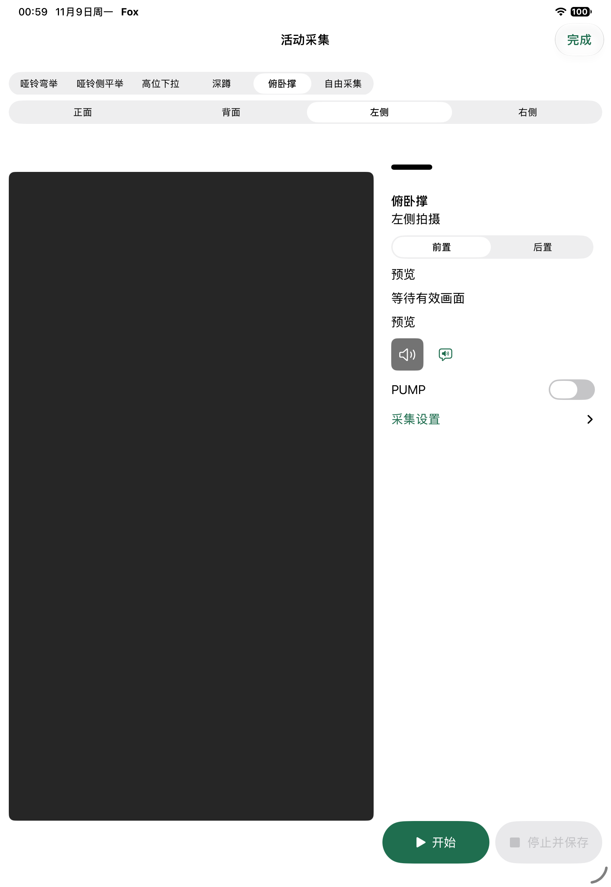

# A Fox activity, from start to review

[Back to Fox](../../README.md) · [Walkthrough HTML (download/open locally)](index.html) · [Public source](../../apps/ipad)

Documentation previews: [desktop](assets/preview-desktop.png) · [390px mobile](assets/preview-mobile.png). These show the responsive walkthrough, not a resized native app layout. GitHub displays the HTML source rather than hosting it as a live site.

**The problem:** a useful training record needs more than a number. It needs the original observation, the recording, and the user's own account of the set.

This walkthrough shows an implemented iPad activity flow captured on November 9, 2026. It uses synthetic input in the real app, not a concept rendering. No person exercised for this demonstration, and no real model service was called.

## 1. Start an activity

The home card offers “Start” and “View records” for the push-up experiment. Daily text and photo capture remain available on the same home screen.

## 2. Capture a segment

The activity opens the shared camera workspace with push-up and left-side viewpoint selected. Start, then stop and save. The dark preview is intentional in this no-person simulator fixture; it is not a camera accuracy demonstration.

## 3. Review what was saved

The result offers the retained video, an optional manual reference count and a note. Automatic observation is **unknown**; actual repetitions are **unconfirmed**. Neither is silently converted to zero. Analysis is a separate, explicit action, not a side effect of opening the record.

**Result of this story:** the synthetic activity reached its result page, and the test opened its video player. The same historical test then explicitly requested a fake-service response. That simulated response is not shown as real AI feedback here.

## Evidence and provenance

- Capture date: **2026-11-09**, iPad simulator, Chinese native interface. These are original full-frame PNGs, not generated mockups or composited screens.
- Source snapshot: local development commit `789e99c` (activity-card flow, before the build48 result unification). The later installed build48 is not represented as the source of these images.
- Test: `FoxActivityDemoUITests.testSyntheticActivityScreens`. A [verbatim source snapshot](evidence/FoxActivityDemoUITests.swift.txt) is included for inspection, not as an independently runnable replacement for its development branch.
- Fixtures: `no_person`, synthetic video retention, fake activity service, reset test store. No personal photos, real workout video, credentials, device IDs or private feedback are included.
- Rights: project-authored Fox interface and synthetic demonstration, published by the project owner. Source and project-authored documentation follow the repository's [MIT license](../../LICENSE); platform UI remains Apple's. No third-party exercise dataset is redistributed.
- Integrity: [asset manifest](assets.json) records SHA-256 and byte size. Test export metadata and private receipts are deliberately not published.
- Availability: public main is an earlier baseline. This publication adds documentation only; it does not make the later development UI buildable from main. The public [journal tests](../../apps/ipad/FoxUITests/FoxJournalUITests.swift) and [training tests](../../apps/ipad/FoxUITests/FoxNativeUITests.swift) provide inspectable baseline persistence behavior.

## Verification status

Historical synthetic screenshots and test source were inspected for this publication. No native test, physical exercise, paid analysis or device installation was performed for the showcase.

[CI run 42963894362](https://github.com/li1fang/fox/actions/runs/42963894362) failed in public-web and native readiness diagnostics; the full native job was skipped. It remains a failure. The documentation checks and responsive previews described in the [publication receipt](RECEIPT.zh-CN.md) are not a replacement for product acceptance.

Vision is experimental and exercise-specific. Push-up counting has failed on real trials and independent evaluation; those failures are not fixed by this flow or by these screenshots. Occlusion, viewpoint and missing joints remain important limitations. No general accuracy, force accuracy, medical or autonomous coaching claim is made.

## Read the implementation

- [SwiftUI application](../../apps/ipad/FoxNative) and [module boundaries](../development/MODULES.md)
- [Training core](../../apps/ipad/FoxTrainingCore) and [motion strategies](../fitness/VISION_STRATEGY_AND_EVIDENCE_V1.zh-CN.md)
- [Local record storage](../../apps/ipad/FoxJournalCore) and [storage design](../journal/RECORD_STORAGE_V1.zh-CN.md)
- [Build and verification guide](../development/VERIFICATION.md), pinned to the public branch's toolchain

The engineering story is the separation of observations, user input and derived conclusions, backed by testable boundaries. It is not a promise that computer vision can yet coach every workout reliably.
